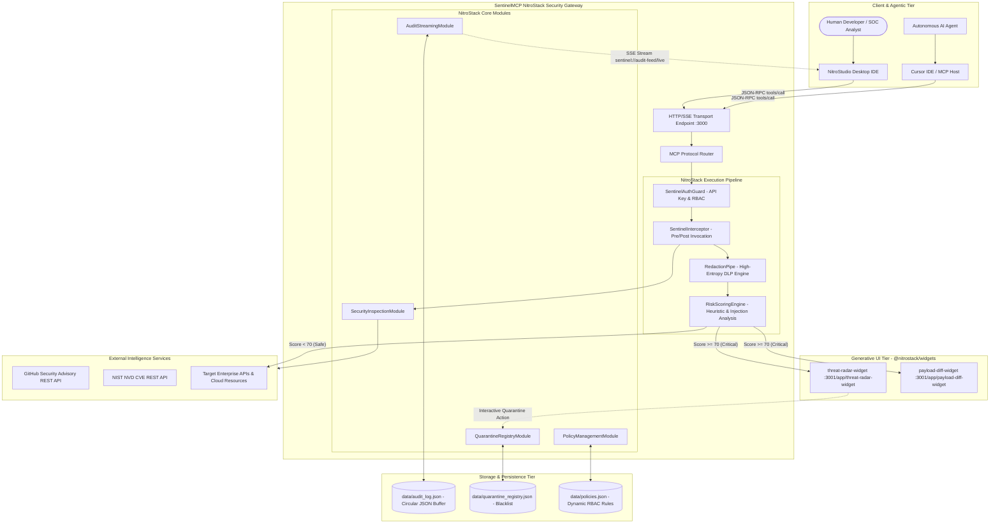
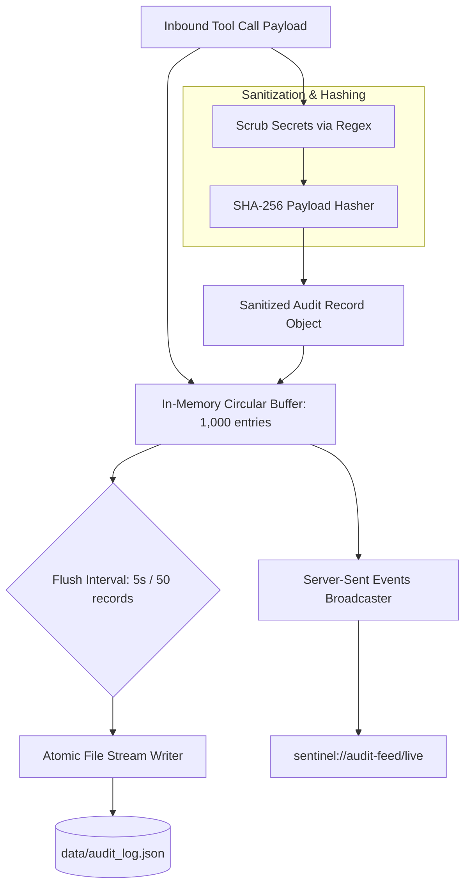
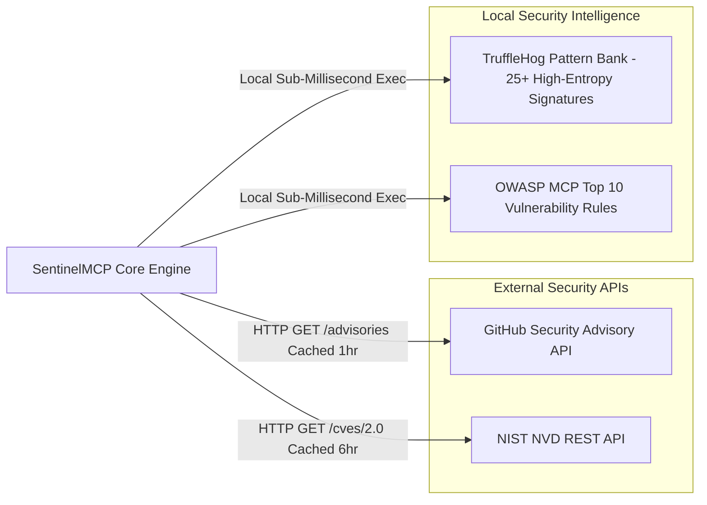
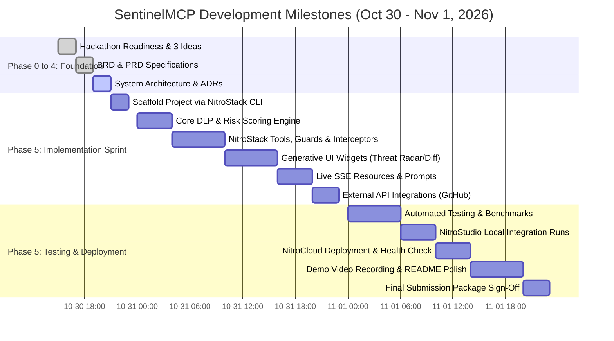

# SYSTEM ARCHITECTURE & TECHNICAL DESIGN DOCUMENT

## Project: SentinelMCP — Autonomous AI Agent Security Operations Center & Zero-Trust MCP Firewall
**Document Version:** 1.0.0  
**Date:** October 30, 2026  
**Status:** Approved Architectural Blueprint  
**Platform:** NitroStack Framework (`@nitrostack/core`, `@nitrostack/widgets`, `@nitrostack/cli`)  
**Target:** NitroStack × MCP To The Moon Buildathon at Fronthyre  

---

## 1. ARCHITECTURAL OVERVIEW & DESIGN PRINCIPLES

### 1.1 Overview
SentinelMCP is architected as an enterprise-grade, high-performance runtime security gateway and observability copilot built natively on the **NitroStack Framework**. It functions as both a standalone security server exposing defensive tools/resources and a zero-trust proxy layer intercepting JSON-RPC 2.0 messages between MCP clients (Cursor, NitroStudio, Claude Desktop) and target enterprise tools.

```
┌────────────────────────────────────────────────────────────────────────┐
│                        SENTINEL MCP ECOSYSTEM                          │
├─────────────────────┬───────────────────┬──────────────────────────────┤
│ Inbound Interception│ Core Defense      │ Generative UI & Observability│
│ • JSON-RPC Proxy    │ • Regex DLP Pipe  │ • Threat Radar Widget        │
│ • Auth & RBAC Guard │ • Heuristic Engine│ • Payload Diff Widget        │
│ • Schema Validator  │ • Quarantine DB   │ • Live Audit SSE Resource    │
└─────────────────────┴───────────────────┴──────────────────────────────┘
```

### 1.2 Core Architectural Principles
1. **Protocol Native:** Built around standard Model Context Protocol (MCP 2024-11-05) JSON-RPC specs. Zero proprietary wrappers or invasive client patches.
2. **Deterministic-First Defense:** Latency is the primary killer of agent UX. The inline execution path relies on pre-compiled ECMAScript regex (TruffleHog patterns) and sub-millisecond AST heuristics, adding `< 35ms` latency overhead.
3. **Fail-Closed Security:** In the event of schema parse errors, unhandled exceptions, or timeout anomalies, the engine rejects tool execution with standardized error code `-32001`.
4. **Decoupled Generative UI:** Next.js client widgets render via `@nitrostack/widgets` SDK, decoupled from backend execution. Tool outputs drive reactive UI states independently.
5. **Zero Secret Persistence:** Scrubbed credentials are never written to disk, stdout, or cloud logging.

---

## 2. FULL SYSTEM ARCHITECTURE DIAGRAM



---

## 3. CONTAINER ARCHITECTURE & RUNTIME PROCESSES

```mermaid
flowchart LR
    subgraph Host_Environment [Node.js v24 Runtime / NitroCloud Container]
        subgraph Backend_Process [Process 1: NitroStack MCP Core Server]
            ExpressSSE[HTTP / SSE Server - Port 3000]
            CoreDI[NitroStack DI Container]
            ToolsRegistry[Registered @Tool Handlers]
            ResourcesRegistry[Registered @Resource Streams]
            PromptsRegistry[Registered @Prompt Templates]
        end

        subgraph Frontend_Process [Process 2: NitroStack Widgets Dev/Prod Server]
            NextServer[Next.js 15 Client Engine - Port 3001]
            WidgetsRouter[App Router: /threat-radar-widget, /payload-diff-widget]
            WidgetSDKClient[@nitrostack/widgets SDK Provider]
        end

        subgraph Local_Storage [Local Storage Volume]
            DataDir[/data directory - Persistent JSON stores]
        end
    end

    ExpressSSE <-->|IPC / HTTP SSE State Bridge| NextServer
    CoreDI <--> DataDir
```

* **Process 1 (Core MCP Engine):** Runs on port `3000`. Handles protocol handshake, stdio/SSE transport, dependency injection, security guards, interceptors, and tool executions.
* **Process 2 (Generative UI Next.js Server):** Runs on port `3001`. Serves Next.js React client components consumed by NitroStudio and modern MCP web hosts.
* **Communication Pattern:** The client component consumes live tool output directly via `useWidgetSDK()` postMessage / SSE bridge.

---

## 4. COMPONENT ARCHITECTURE & MODULE BREAKDOWN

```
src/
├── app.module.ts                   # Root NitroStack application module
├── config/
│   ├── configuration.ts            # Environment and runtime configurations
│   └── regex-patterns.ts           # High-performance DLP & injection regexes
├── modules/
│   ├── security/                   # Core Security Inspection Module
│   │   ├── security.module.ts
│   │   ├── security.service.ts
│   │   ├── security.tools.ts       # inspect_payload_safety, redact_sensitive_context, scan_manifest
│   │   ├── interceptors/
│   │   │   └── sentinel.interceptor.ts
│   │   ├── pipes/
│   │   │   └── redaction.pipe.ts
│   │   └── engines/
│   │       ├── dlp.engine.ts
│   │       └── risk-scoring.engine.ts
│   ├── quarantine/                 # Active Quarantine & Blacklisting Module
│   │   ├── quarantine.module.ts
│   │   ├── quarantine.service.ts
│   │   └── quarantine.tools.ts     # quarantine_rogue_tool
│   ├── audit/                      # Observability & Resource Streaming Module
│   │   ├── audit.module.ts
│   │   ├── audit.service.ts
│   │   └── audit.resources.ts      # sentinel://audit-feed/live
│   └── policy/                     # Dynamic RBAC & Prompt Module
│       ├── policy.module.ts
│       ├── policy.service.ts
│       ├── policy.guards.ts        # SentinelAuthGuard
│       └── policy.prompts.ts       # triage_security_incident, generate_soc2_report
└── widgets/                        # Next.js Generative UI components
    └── app/
        ├── threat-radar-widget/
        │   └── page.tsx
        └── payload-diff-widget/
            └── page.tsx
```

---

## 5. MCP ARCHITECTURE MAPPING

| MCP Primitive | Identifier / Name | Module Owner | Description & Functionality |
|:---|:---|:---|:---|
| **Tool** | `inspect_payload_safety` | `SecurityModule` | Evaluates tool arguments for prompt injection, jailbreaks, shell escapes, and SQL injection syntax. Attached to `threat-radar-widget`. |
| **Tool** | `redact_sensitive_context` | `SecurityModule` | Detects and replaces AWS, GitHub, Stripe, and PII tokens with semantic redaction badges. Attached to `payload-diff-widget`. |
| **Tool** | `scan_mcp_server_manifest` | `SecurityModule` | Audits an MCP server manifest for OWASP MCP Top 10 vulnerabilities (Tool Poisoning, excessive agency). |
| **Tool** | `quarantine_rogue_tool` | `QuarantineModule`| Sandboxes or bans a tool dynamically, persisting the blacklisted state in the quarantine registry. |
| **Tool** | `enforce_least_privilege_policy`| `PolicyModule` | Applies zero-trust RBAC profiles to restrict calling agents to approved toolsets. |
| **Tool** | `get_firewall_status` | `SecurityModule` | Exposes operational metrics: uptime, inspected calls, scrubbed tokens, active threats. |
| **Resource** | `sentinel://audit-feed/live` | `AuditModule` | Real-time SSE stream of all tool execution events, parameter hashes, risk scores, and verdicts. |
| **Resource** | `sentinel://policies/active` | `PolicyModule` | Active JSON schema of RBAC rules, DLP regex patterns, and risk thresholds. |
| **Resource** | `sentinel://quarantine/registry`| `QuarantineModule`| JSON list of all quarantined tools, timestamps, and justifications. |
| **Prompt** | `triage_security_incident` | `PolicyModule` | Orchestrated agent runbook for investigating flagged payloads and correlating audit events. |
| **Prompt** | `generate_soc2_compliance_report`| `PolicyModule` | Synthesizes historical audit data into an executive AI governance compliance markdown document. |
| **Widget** | `threat-radar-widget` | `src/widgets/app` | Interactive Next.js component rendering risk gauge (0–100) and 1-click quarantine trigger. |
| **Widget** | `payload-diff-widget` | `src/widgets/app` | Dual-pane interactive diff visualizer showing raw tainted input vs. scrubbed output. |

---

## 6. DATA ARCHITECTURE & FLOW



### Storage Strategy
* **Audit Persistence:** Append-only atomic writes to `data/audit_log.json`. Rotates when file exceeds 25MB.
* **Quarantine Persistence:** Key-value document store in `data/quarantine_registry.json`. Synchronously updated on quarantine actions.
* **In-Memory Cache:** Fast LRU cache (1,000 items) for sub-millisecond status queries and duplicate tool call deduplication.

---

## 7. INTEGRATION ARCHITECTURE



* **GitHub Advisory API:** Real-time query to check if dependencies exposed by third-party MCP servers have open CVEs. Fallback: Internal cached top-50 vulnerabilities.
* **TruffleHog Regex Bank:** 100% local compiled RegExp matching AWS, GitHub, Stripe, Slack, and private key structures with zero external API latency or costs.

---

## 8. REPOSITORY ARCHITECTURE & DIRECTORY STRUCTURE

```
serene-davinci/
├── package.json                    # Root workspace package.json
├── tsconfig.json                   # TypeScript configuration (strict mode)
├── .env.example                    # Environment template (NO SECRETS COMMITTED)
├── .gitignore                      # Git exclusion rules (node_modules, data/, .env)
├── README.md                       # Comprehensive project README & documentation
├── HACKATHON_READINESS.md          # Phase 0 readiness report
├── THREE_PROJECT_IDEAS.md          # Phase 1 project proposals & scoring
├── docs/                           # Architecture & product documentation
│   ├── BRD.md
│   ├── PRD.md
│   ├── MCP_CAPABILITY_CATALOGUE.md
│   ├── USER_JOURNEYS.md
│   ├── ACCEPTANCE_CRITERIA.md
│   ├── ARCHITECTURE.md
│   ├── DATABASE_DESIGN.md
│   ├── SECURITY_DESIGN.md
│   ├── INTEGRATIONS.md
│   ├── DEPLOYMENT.md
│   └── ADRs/
│       ├── ADR-001-framework-selection.md
│       ├── ADR-002-zero-trust-interceptor-pipeline.md
│       ├── ADR-003-generative-ui-widgets-architecture.md
│       └── ADR-004-storage-and-audit-strategy.md
├── src/
│   ├── main.ts                     # MCP server bootstrap entry point
│   ├── app.module.ts               # Root application dependency injection module
│   ├── common/                     # Cross-cutting utilities, types, and constants
│   │   ├── constants.ts
│   │   ├── interfaces.ts
│   │   └── utils.ts
│   ├── config/
│   │   ├── configuration.ts
│   │   └── regex-patterns.ts
│   ├── modules/
│   │   ├── security/
│   │   ├── quarantine/
│   │   ├── audit/
│   │   └── policy/
│   └── widgets/                    # Next.js Generative UI Client App
│       ├── package.json
│       ├── tsconfig.json
│       ├── next.config.js
│       ├── tailwind.config.js
│       └── app/
│           ├── layout.tsx
│           ├── threat-radar-widget/
│           │   └── page.tsx
│           └── payload-diff-widget/
│               └── page.tsx
├── tests/                          # Automated test suites
│   ├── unit/
│   │   ├── dlp-engine.spec.ts
│   │   ├── risk-scoring.spec.ts
│   │   └── quarantine.spec.ts
│   ├── integration/
│   │   ├── mcp-tools.spec.ts
│   │   └── interceptor-pipeline.spec.ts
│   └── e2e/
│       └── full-attack-scenario.spec.ts
└── data/                           # Runtime persistent JSON data (Git-ignored)
    ├── .gitkeep
    ├── audit_log.json
    └── quarantine_registry.json
```

---

## 9. TESTING STRATEGY & QUALITY GATES

| Testing Phase | Scope & Tools | Target Metrics |
|:---|:---|:---|
| **Unit Testing** | Jest / Vitest: DLP regex pattern matching, prompt injection scoring calculations, RBAC permission evaluation. | > 85% code coverage; 100% secret detection on benchmark tokens. |
| **Integration Testing** | NitroStack module wiring, Guard & Interceptor execution pipelines, local JSON persistence. | 0 unhandled promise rejections; fail-closed verification. |
| **Protocol Testing** | Official MCP inspector & JSON-RPC schema compliance testing. | 100% compliant with MCP 2024-11-05 specifications. |
| **Generative UI Testing** | Next.js component rendering with `@nitrostack/widgets` mock SDK provider. | Component renders cleanly in < 300ms without console errors. |
| **Performance Benchmark**| Load test script executing 100 consecutive tool invocations. | Average latency < 35ms; p95 < 50ms. |
| **Live Hackathon Demo Run**| End-to-end dry run of the 5-minute attack-and-containment script in NitroStudio. | Flawless live execution. |

---

## 10. HACKATHON DELIVERY PLAN (OCTOBER 30 – NOVEMBER 1)



---

### ARCHITECTURE SUMMARY & TECHNICAL RISKS REVIEW
* **Risk 1:** Sub-50ms latency SLA with complex payloads.  
  *Resolution:* Fast-path deterministic regex engine handles 95% of normal checks without triggering heavy LLM evaluation.
* **Risk 2:** Widget state synchronization with backend.  
  *Resolution:* Native `@nitrostack/widgets` `useWidgetSDK()` hook ensures reactive event binding without custom WebSockets.
