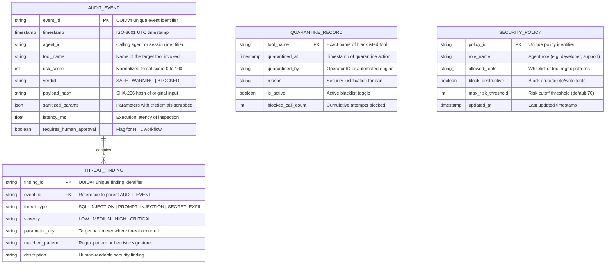

# DATABASE & PERSISTENCE ARCHITECTURE DESIGN

## Project: SentinelMCP — Autonomous AI Agent Security Operations Center & Zero-Trust MCP Firewall
**Document Version:** 1.0.0  
**Date:** October 30, 2026  
**Status:** Approved Technical Design  
**Platform:** NitroStack Framework (`@nitrostack/core`)  

---

## 1. DATA STORAGE STRATEGY

For the **NitroStack × MCP To The Moon Hackathon**, SentinelMCP implements a high-performance, resilient, and zero-external-dependency persistence architecture. Rather than introducing brittle external database servers (e.g., PostgreSQL, Redis) that introduce network latency, cost overhead, and deployment friction, SentinelMCP utilizes a **Two-Tier Storage Architecture**:

1. **Tier 1 (In-Memory Hot Cache & Circular Ring Buffer):** Provides sub-millisecond lookups for real-time tool interception, rate limiting, and quarantine checks.
2. **Tier 2 (Atomic Append-Only JSON Persistent Store):** Persists audit logs, active quarantine lists, and custom RBAC policies to disk (`data/*.json`) using atomic file operations.

```
┌────────────────────────────────────────────────────────────────────────┐
│                     SENTINEL MCP STORAGE ENGINE                        │
├──────────────────────────────────┬─────────────────────────────────────┤
│ Tier 1: In-Memory Ring Buffer    │ Tier 2: Atomic JSON Disk Store      │
│ • Sub-millisecond latency        │ • Append-only audit log             │
│ • Circular buffer (1,000 items)  │ • Flushed periodically (every 5s)   │
│ • In-memory blacklist registry   │ • Survives server restarts          │
└──────────────────────────────────┴─────────────────────────────────────┘
```

---

## 2. ENTITY RELATIONSHIP DIAGRAM (ERD)



---

## 3. SCHEMAS & DATA STRUCTURES

### 3.1 Audit Event Schema (`data/audit_log.json`)
```typescript
export interface ThreatFinding {
  finding_id: string;
  threat_type: 'PROMPT_INJECTION' | 'SQL_INJECTION' | 'SECRET_EXFILTRATION' | 'PII_LEAK' | 'MALICIOUS_SHELL';
  severity: 'LOW' | 'MEDIUM' | 'HIGH' | 'CRITICAL';
  parameter_key: string;
  matched_pattern: string;
  description: string;
}

export interface AuditEventRecord {
  event_id: string;
  timestamp: string;
  agent_id: string;
  tool_name: string;
  risk_score: number;
  verdict: 'SAFE' | 'WARNING' | 'BLOCKED';
  payload_hash: string;
  sanitized_params: Record<string, any>;
  findings: ThreatFinding[];
  latency_ms: number;
  requires_human_approval: boolean;
}
```

### 3.2 Quarantine Registry Schema (`data/quarantine_registry.json`)
```typescript
export interface QuarantineRecord {
  tool_name: string;
  quarantined_at: string;
  quarantined_by: string;
  reason: string;
  is_active: boolean;
  blocked_call_count: number;
}

export interface QuarantineRegistryFile {
  version: string;
  updated_at: string;
  quarantined_tools: Record<string, QuarantineRecord>;
}
```

### 3.3 Dynamic Security Policies Schema (`data/policies.json`)
```typescript
export interface SecurityPolicyRule {
  policy_id: string;
  role_name: string;
  allowed_tools: string[];
  block_destructive: boolean;
  max_risk_threshold: number;
  updated_at: string;
}
```

---

## 4. DATA OWNERSHIP & VALIDATION RULES

1. **Schema Validation:** All data ingested into storage must pass runtime Zod schema validation. Any malformed object is rejected before mutating in-memory or on-disk stores.
2. **Atomic Disk Persistence:** To prevent file corruption during sudden server shutdowns or power interruptions, writes to `data/*.json` write first to a temporary file (`data/*.tmp`) before atomically renaming (`fs.renameSync`) to the destination file.
3. **Circular Buffer Retention:** The in-memory audit store caps at **1,000 records**. When capacity is reached, the oldest record is evicted (FIFO).
4. **Log Rotation:** The persistent `data/audit_log.json` file is monitored. When it exceeds **25 megabytes**, it rotates to `data/audit_log.1.json`, keeping the active file lean and performant.

---

## 5. ZERO SECRET PERSISTENCE & PRIVACY CONTROLS

1. **Deterministic Redaction Before Persistence:** The `RedactionPipe` executes *before* any audit record is constructed. Raw unscrubbed credentials never touch the storage layer.
2. **Cryptographic Non-Repudiation:** The original payload is hashed using **SHA-256** (`payload_hash`). This allows security analysts to prove mathematically whether a specific query was received without exposing the raw secret in the database.
3. **Git Exclusion:** The entire `data/` directory is strictly excluded from version control via `.gitignore`, except for `.gitkeep`.
