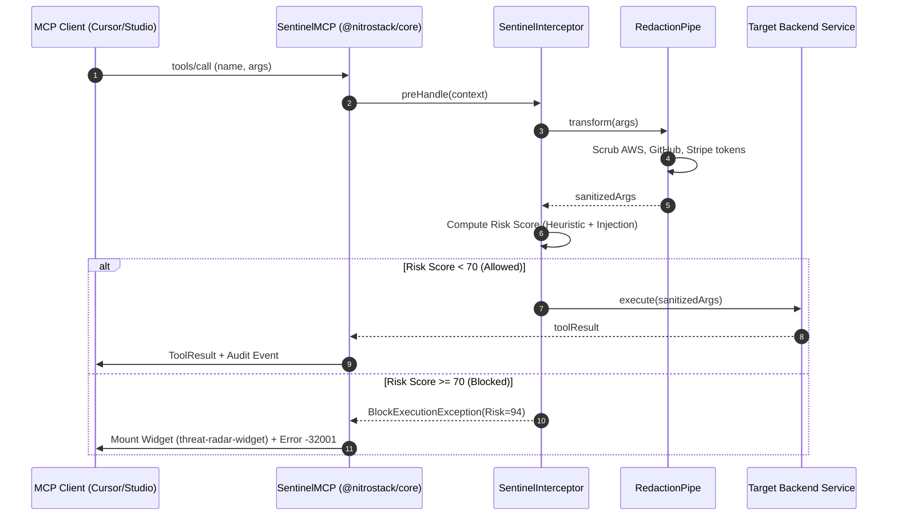

# MODEL CONTEXT PROTOCOL (MCP) CAPABILITY CATALOGUE

## Project: SentinelMCP — Autonomous AI Agent Security Operations Center & Zero-Trust MCP Firewall
**Document Version:** 1.0.0  
**Date:** October 30, 2026  
**Platform:** NitroStack Framework (`@nitrostack/core`, `@nitrostack/widgets`)  
**Target Standard:** Model Context Protocol (MCP) JSON-RPC 2.0  

---

## 1. ARCHITECTURAL OVERVIEW

SentinelMCP exposes its security services through standard Model Context Protocol primitives. Every capability is declared using official **NitroStack Decorators** (`@Tool`, `@Resource`, `@Prompt`, `@Widget`, `@UseGuards`, `@UseInterceptors`), ensuring strict schema enforcement and zero boilerplate:

```
┌────────────────────────────────────────────────────────────────────────┐
│                        SENTINEL MCP SERVER CORE                        │
├─────────────────────┬───────────────────┬──────────────────────────────┤
│ Tools (@Tool)       │ Resources         │ Prompts (@Prompt)            │
│ • scan_manifest     │ (@Resource)       │ • triage_security_incident   │
│ • inspect_payload   │ • audit-feed/live │ • generate_soc2_report       │
│ • redact_secrets    │ • policies/active │ • red_team_simulation       │
│ • quarantine_tool   │ • quarantine/list ├──────────────────────────────┤
│ • least_privilege   │                   │ Generative UI (@Widget)      │
│ • get_firewall_stat │                   │ • threat-radar-widget        │
│                     │                   │ • payload-diff-widget        │
└─────────────────────┴───────────────────┴──────────────────────────────┘
```

---

## 2. MCP TOOLS SPECIFICATION

### 2.1 Tool: `inspect_payload_safety`
* **Purpose:** Inspects inbound agent tool parameters for prompt injection, jailbreaks, destructive shell commands, and SQL injections.
* **Decorator Signature:**
  ```typescript
  @Tool({
    name: 'inspect_payload_safety',
    description: 'Inspects and scores tool arguments for indirect prompt injection, SQL injection, OS escapes, and anomalous payloads.',
    inputSchema: z.object({
      tool_name: z.string().describe('The name of the target tool being invoked'),
      parameters: z.record(z.any()).describe('Key-value map of parameters passed to the tool'),
      agent_id: z.string().optional().describe('Unique identifier of the calling agent or session'),
    }),
  })
  @Widget('threat-radar-widget')
  ```
* **Input Schema (JSON Schema):**
  ```json
  {
    "type": "object",
    "properties": {
      "tool_name": { "type": "string" },
      "parameters": { "type": "object", "additionalProperties": true },
      "agent_id": { "type": "string" }
    },
    "required": ["tool_name", "parameters"]
  }
  ```
* **Output Schema:**
  ```json
  {
    "type": "object",
    "properties": {
      "verdict": { "type": "string", "enum": ["SAFE", "WARNING", "BLOCKED"] },
      "risk_score": { "type": "integer", "minimum": 0, "maximum": 100 },
      "findings": {
        "type": "array",
        "items": {
          "type": "object",
          "properties": {
            "threat_type": { "type": "string" },
            "severity": { "type": "string", "enum": ["LOW", "MEDIUM", "HIGH", "CRITICAL"] },
            "parameter": { "type": "string" },
            "matched_pattern": { "type": "string" },
            "description": { "type": "string" }
          }
        }
      },
      "requires_human_approval": { "type": "boolean" },
      "sanitized_parameters": { "type": "object" },
      "latency_ms": { "type": "number" }
    },
    "required": ["verdict", "risk_score", "findings", "sanitized_parameters"]
  }
  ```
* **Authentication & Permissions:** Available to all registered agents and SOC analysts.
* **Side Effects:** Appends an audit event to the in-memory circular buffer and disk log.
* **Error Handling:** Returns MCP JSON-RPC code `-32602` for invalid parameters; falls back to `BLOCKED` with risk score 100 on fatal inspection failure.

---

### 2.2 Tool: `redact_sensitive_context`
* **Purpose:** High-performance DLP tool that detects and scrubs credentials, private keys, and PII from raw string parameters or objects.
* **Decorator Signature:**
  ```typescript
  @Tool({
    name: 'redact_sensitive_context',
    description: 'Scans text or structured objects for API keys, AWS credentials, tokens, and PII, returning the sanitized payload.',
    inputSchema: z.object({
      payload: z.union([z.string(), z.record(z.any())]).describe('Raw text or JSON payload to sanitize'),
      strict_mode: z.boolean().default(true).describe('If true, redacts borderline high-entropy strings'),
    }),
  })
  @Widget('payload-diff-widget')
  ```
* **Input Schema:**
  ```json
  {
    "type": "object",
    "properties": {
      "payload": { "oneOf": [{ "type": "string" }, { "type": "object" }] },
      "strict_mode": { "type": "boolean", "default": true }
    },
    "required": ["payload"]
  }
  ```
* **Output Schema:**
  ```json
  {
    "type": "object",
    "properties": {
      "sanitized_payload": { "oneOf": [{ "type": "string" }, { "type": "object" }] },
      "redacted_count": { "type": "integer" },
      "redactions": {
        "type": "array",
        "items": {
          "type": "object",
          "properties": {
            "category": { "type": "string" },
            "placeholder": { "type": "string" },
            "occurrences": { "type": "integer" }
          }
        }
      },
      "raw_hash": { "type": "string" }
    },
    "required": ["sanitized_payload", "redacted_count", "redactions"]
  }
  ```
* **Side Effects:** None. Idempotent transformation.

---

### 2.3 Tool: `scan_mcp_server_manifest`
* **Purpose:** Audits a target MCP server's exposed tools and JSON schemas against the OWASP MCP Top 10 vulnerabilities.
* **Decorator Signature:**
  ```typescript
  @Tool({
    name: 'scan_mcp_server_manifest',
    description: 'Audits an MCP server manifest or tool list for insecure schemas, tool description poisoning, and dangerous capabilities.',
    inputSchema: z.object({
      manifest_json: z.string().describe('The raw JSON manifest or tools/list output from the target server'),
      server_name: z.string().optional().describe('Name or URL of the target MCP server'),
    }),
  })
  ```
* **Input Schema:**
  ```json
  {
    "type": "object",
    "properties": {
      "manifest_json": { "type": "string" },
      "server_name": { "type": "string" }
    },
    "required": ["manifest_json"]
  }
  ```
* **Output Schema:**
  ```json
  {
    "type": "object",
    "properties": {
      "server_name": { "type": "string" },
      "security_grade": { "type": "string", "enum": ["A", "B", "C", "D", "F"] },
      "total_tools_scanned": { "type": "integer" },
      "vulnerabilities": {
        "type": "array",
        "items": {
          "type": "object",
          "properties": {
            "tool_name": { "type": "string" },
            "owasp_code": { "type": "string" },
            "severity": { "type": "string" },
            "description": { "type": "string" },
            "remediation": { "type": "string" }
          }
        }
      },
      "recommended_action": { "type": "string", "enum": ["ALLOW", "REQUIRE_RESTRICTION", "QUARANTINE"] }
    },
    "required": ["security_grade", "total_tools_scanned", "vulnerabilities", "recommended_action"]
  }
  ```
* **Integrations:** Queries GitHub Advisory API and local OWASP MCP signature bank.

---

### 2.4 Tool: `quarantine_rogue_tool`
* **Purpose:** Immediately adds a compromised, untrusted, or dangerous tool to the SentinelMCP active quarantine blacklist.
* **Decorator Signature:**
  ```typescript
  @Tool({
    name: 'quarantine_rogue_tool',
    description: 'Blacklists a specific tool or entire MCP server from being executed by AI agents.',
    inputSchema: z.object({
      tool_name: z.string().describe('Exact identifier of the tool to quarantine'),
      reason: z.string().describe('Security justification for the quarantine action'),
      operator_id: z.string().default('soc-analyst').describe('ID of the human or agent initiating quarantine'),
    }),
  })
  ```
* **Input Schema:**
  ```json
  {
    "type": "object",
    "properties": {
      "tool_name": { "type": "string" },
      "reason": { "type": "string" },
      "operator_id": { "type": "string" }
    },
    "required": ["tool_name", "reason"]
  }
  ```
* **Output Schema:**
  ```json
  {
    "type": "object",
    "properties": {
      "success": { "type": "boolean" },
      "tool_name": { "type": "string" },
      "quarantined_at": { "type": "string" },
      "total_active_quarantines": { "type": "integer" }
    },
    "required": ["success", "tool_name", "quarantined_at"]
  }
  ```
* **Side Effects:** Writes to persistent `data/quarantine_registry.json`. Emits an alert on `sentinel://audit-feed/live`.

---

### 2.5 Tool: `enforce_least_privilege_policy`
* **Purpose:** Generates and registers dynamic RBAC rules defining permitted tool sets per agent role.
* **Decorator Signature:**
  ```typescript
  @Tool({
    name: 'enforce_least_privilege_policy',
    description: 'Applies or updates zero-trust role-based access control policies for specific AI agent roles.',
    inputSchema: z.object({
      role: z.string().describe('Agent role (e.g., "code-reviewer", "customer-support", "deployer")'),
      allowed_tools: z.array(z.string()).describe('List of explicitly allowed tool name patterns'),
      block_destructive_tools: z.boolean().default(true).describe('Automatically block tools with drop/delete/write capabilities'),
    }),
  })
  ```

---

### 2.6 Tool: `get_firewall_status`
* **Purpose:** Returns real-time health, uptime, total inspected calls, blocked attacks, and active quarantine counts.
* **Decorator Signature:**
  ```typescript
  @Tool({
    name: 'get_firewall_status',
    description: 'Fetches real-time operational metrics and health statistics of the SentinelMCP security engine.',
    inputSchema: z.object({}),
  })
  ```

---

## 3. MCP RESOURCES SPECIFICATION

### 3.1 Resource: `sentinel://audit-feed/live`
* **Name:** Live Security Audit Event Stream
* **MIME Type:** `application/json`
* **Description:** Continuous stream of the latest tool execution verdicts, risk scores, parameter hashes, and latency metrics.
* **Schema:**
  ```json
  {
    "timestamp": "2026-10-30T15:35:00.120Z",
    "event_id": "evt_99182a",
    "agent_id": "claude-dev-01",
    "tool_name": "execute_query",
    "risk_score": 88,
    "verdict": "BLOCKED",
    "threats": ["SQL_INJECTION", "AWS_KEY_EXFIL"],
    "latency_ms": 14.2
  }
  ```

### 3.2 Resource: `sentinel://policies/active`
* **Name:** Active Security & DLP Policies
* **MIME Type:** `application/json`
* **Description:** Exposes the active regex patterns, RBAC role mappings, and risk thresholds enforced by the firewall.

### 3.3 Resource: `sentinel://quarantine/registry`
* **Name:** Quarantined Tools Registry
* **MIME Type:** `application/json`
* **Description:** Current list of blacklisted tools, reasons for quarantine, and operator timestamps.

---

## 4. MCP PROMPT TEMPLATES SPECIFICATION

### 4.1 Prompt: `triage_security_incident`
* **Description:** Automated incident runbook that guides an agent through investigating a flagged tool call, correlating audit logs, and preparing a containment brief.
* **Arguments:**
  - `incident_id` (string, required): The ID of the flagged event in the audit log.
* **Template Structure:**
  ```markdown
  You are Sentinel-SOC, the autonomous Incident Response Agent.
  Investigate the security incident with ID: {{incident_id}}.
  
  Instructions:
  1. Inspect the audit record from sentinel://audit-feed/live.
  2. Extract the tool name, raw parameter hash, and risk score.
  3. Determine if the payload contains an indirect prompt injection or secret exfiltration.
  4. If the risk score is >= 70, recommend executing quarantine_rogue_tool.
  5. Provide a clear, executive post-mortem summary with root-cause analysis.
  ```

### 4.2 Prompt: `generate_soc2_compliance_report`
* **Description:** Synthesizes historical audit data into an executive AI Governance & Compliance Report.
* **Arguments:**
  - `time_window_hours` (integer, default: 24): Period of audit records to evaluate.

---

## 5. GENERATIVE UI WIDGET SPECIFICATION (`@nitrostack/widgets`)

### 5.1 Widget: `threat-radar-widget`
* **Route Path:** `src/widgets/app/threat-radar-widget/page.tsx`
* **Renderer:** React Next.js 15 Client Component using `useWidgetSDK()`.
* **State & Props:**
  - Consumes `getToolOutput<SafetyInspectionResult>()`.
  - Animates radar sweep when `risk_score > 70`.
  - Exposes an interactive action button: `<button onClick={handleQuarantine}>Quarantine Tool</button>` which invokes the MCP tool `quarantine_rogue_tool`.

### 5.2 Widget: `payload-diff-widget`
* **Route Path:** `src/widgets/app/payload-diff-widget/page.tsx`
* **Renderer:** React Next.js 15 Client Component.
* **State & Props:**
  - Consumes `getToolOutput<RedactionResult>()`.
  - Displays dual-pane visual diff:
    - Left Column (Red border): Raw unscrubbed parameters with red highlight badges.
    - Right Column (Green border): Sanitized payload with `[REDACTED_*]` badges.

---

## 6. AGENT WORKFLOW & ORCHESTRATION PIPELINE


