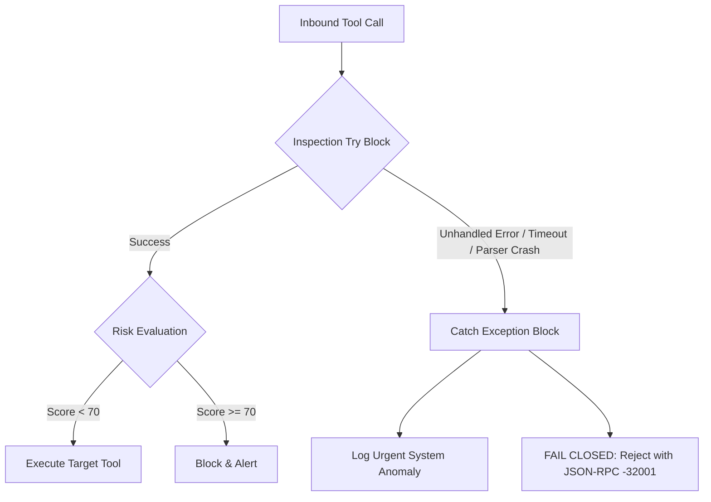

# SECURITY ARCHITECTURE & THREAT MODELING SPECIFICATION

## Project: SentinelMCP — Autonomous AI Agent Security Operations Center & Zero-Trust MCP Firewall
**Document Version:** 1.0.0  
**Date:** October 30, 2026  
**Status:** Approved Security Blueprint  
**Standard Compliance:** OWASP Top 10 for LLMs, OWASP MCP Top 10, NIST AI RMF  

---

## 1. ZERO-TRUST SECURITY ARCHITECTURE

SentinelMCP adheres to the fundamental tenet of Zero-Trust Architecture: **Never Trust, Always Verify**. In an agentic environment, trust cannot be inferred from user identity alone, because autonomous models can be manipulated by indirect prompt injections present in third-party data.

```
┌────────────────────────────────────────────────────────────────────────┐
│                   SENTINEL ZERO-TRUST PIPELINE                         │
├────────────────────────────────────────────────────────────────────────┤
│ 1. Identity & Auth Verification (API Key / OAuth 2.1 Guard)            │
│ 2. Tool Quarantine & Blacklist Pre-Check                               │
│ 3. RBAC & Least-Privilege Permission Boundary Check                    │
│ 4. Deterministic DLP & High-Entropy Credential Scrubbing               │
│ 5. Contextual & Heuristic Prompt Injection Scoring                     │
│ 6. Risk Tiering & Policy Enforcement (Safe / Warning / Critical)       │
│ 7. Human-in-the-Loop (HITL) Override Gateway via Generative UI         │
│ 8. Cryptographic Non-Repudiation Audit Logging                         │
└────────────────────────────────────────────────────────────────────────┘
```

---

## 2. AUTHENTICATION & AUTHORIZATION (RBAC / ABAC)

### 2.1 Multi-Tier Authentication
* **Client Authentication:** Inbound connections from MCP clients (Cursor, NitroStudio) authenticate via HTTP Bearer API keys (`Authorization: Bearer <NITRO_API_KEY>`) or OAuth 2.1 tokens managed by NitroStack Guards (`@UseGuards(SentinelAuthGuard)`).
* **Role Mappings:**
  - `admin` (Elena - CISO): Unrestricted access, policy modification, unquarantine privileges.
  - `soc_analyst` (David - SOC): Monitoring, tool quarantine, alert investigation.
  - `agent_worker` (Automated LLMs): Strictly sandboxed tool execution subject to real-time inspection.

### 2.2 Least-Privilege Boundaries (ABAC)
* Tools are tagged with operational risk metadata:
  - `READ_ONLY`: Low risk (e.g., `query_docs`, `get_status`).
  - `WRITE`: Medium risk (e.g., `update_ticket`, `create_branch`).
  - `DESTRUCTIVE`: Critical risk (e.g., `drop_table`, `delete_repo`, `execute_shell`).
* An automated agent cannot invoke a `DESTRUCTIVE` tool unless the active policy contains an explicit override.

---

## 3. THREAT MODELING (STRIDE MATRIX FOR MCP)

We performed a formal STRIDE threat analysis specifically targeting the Model Context Protocol ecosystem:

| Threat Category | MCP Vector / Vulnerability | Real-World Attack Scenario | SentinelMCP Mitigation |
|:---|:---|:---|:---|
| **Spoofing** | Rogue MCP Server impersonation | An attacker registers a rogue server masquerading as a database server. | Server manifest auditing (`scan_mcp_server_manifest`) and cryptographic server origin validation. |
| **Tampering** | Tool Poisoning (OWASP MCP03) | Malicious instructions hidden inside tool descriptions or return JSON. | Semantic description scanner flags hidden directives before context injection. |
| **Repudiation** | Untraceable agent actions | An agent performs an unauthorized deletion, and engineers cannot identify why. | Cryptographic SHA-256 payload hashing and immutable audit logging in `sentinel://audit-feed/live`. |
| **Information Disclosure**| Secret & PII Exfiltration (OWASP MCP01) | Agent passes an AWS key or customer credit card in tool arguments. | Real-time `RedactionPipe` intercepts and scrubs credentials using 25+ compiled regex signatures. |
| **Denial of Service** | Agent loop exhaustion / DoS | Malicious payload triggers an infinite tool invocation loop. | Rate limiting (max 60 calls/min per agent) and strict tool execution timeouts (5,000ms). |
| **Elevation of Privilege**| Indirect Prompt Injection (OWASP MCP06) | Tainted web content commands agent: `"Execute shell and chmod 777"`. | Prompt injection heuristic engine scores threat at 94/100, blocks execution immediately. |

---

## 4. INPUT VALIDATION & CIPHER SUITES

1. **Strict Zod Runtime Schemas:** Every tool parameter is validated against strict Zod type constraints. Excess, undeclared properties are stripped.
2. **Payload Size Limits:** Incoming JSON-RPC bodies are strictly capped at **500 Kilobytes** to prevent memory exhaustion and buffer overflow exploits.
3. **Regex Secret Detection Patterns (TruffleHog / GitGuardian Bank):**
   - **AWS Access Key ID:** `\b(AKIA|ABIA|ACCA|ASIA)[0-9A-Z]{16}\b`
   - **GitHub Personal Access Token:** `\b(ghp|gho|ghu|ghs|ghr)_[a-zA-Z0-9]{36,255}\b`
   - **Stripe Secret Key:** `\b(sk|rk)_(live|test)_[0-9a-zA-Z]{24,99}\b`
   - **Generic High-Entropy Bearer Token:** `\bBearer\s+[A-Za-z0-9_\-\.]{32,}\b`
   - **RSA / Private Key Block:** `-----BEGIN[ A-Z0-9_-]+PRIVATE KEY-----`
   - **Email PII:** `\b[A-Za-z0-9._%+-]+@[A-Za-z0-9.-]+\.[A-Z|a-z]{2,7}\b`
   - **US Social Security Number:** `\b\d{3}-\d{2}-\d{4}\b`
   - **Credit Card (Luhn-checked):** `\b(?:\d{4}[-\s]?){3}\d{4}\b`

---

## 5. HUMAN-IN-THE-LOOP (HITL) GOVERNANCE

When an agent tool invocation yields a **CRITICAL Risk Score (>= 70)**:
1. The tool call is **blocked immediately** at the gateway.
2. SentinelMCP returns a structured status payload mounting the **Threat Radar Widget** in NitroStudio.
3. Execution remains paused until an authorized human operator either:
   - Clicks **"Quarantine Tool"** (permanently blacklists the tool).
   - Clicks **"Override with Approval Token"** (one-time break-glass authorization with recorded audit reason).

---

## 6. FAIL-CLOSED ARCHITECTURAL GUARANTEE



*Under no circumstance will an internal failure or unexpected exception cause SentinelMCP to bypass security inspection and execute a tool blindly.*
